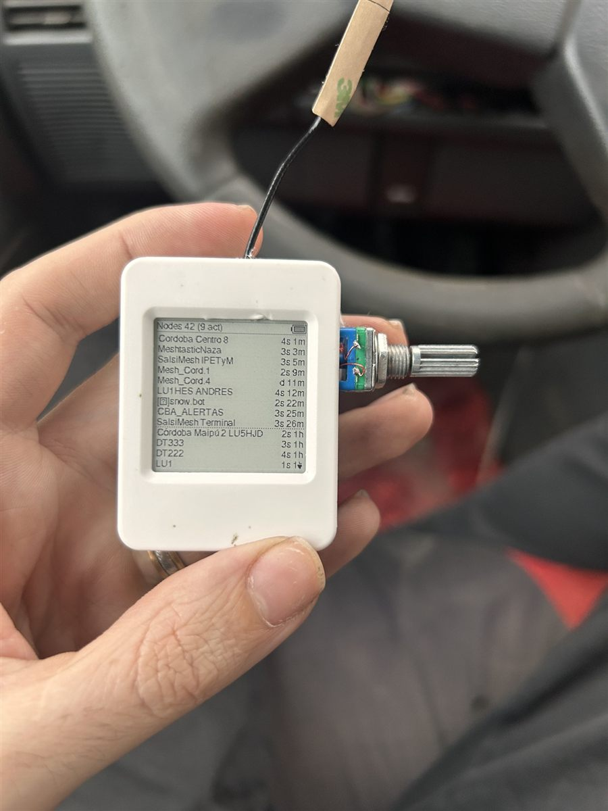
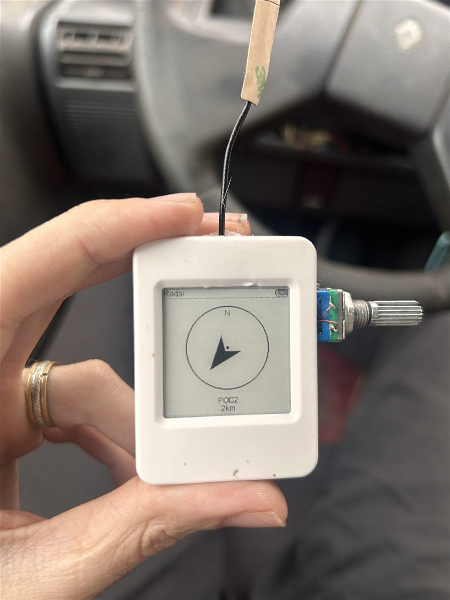
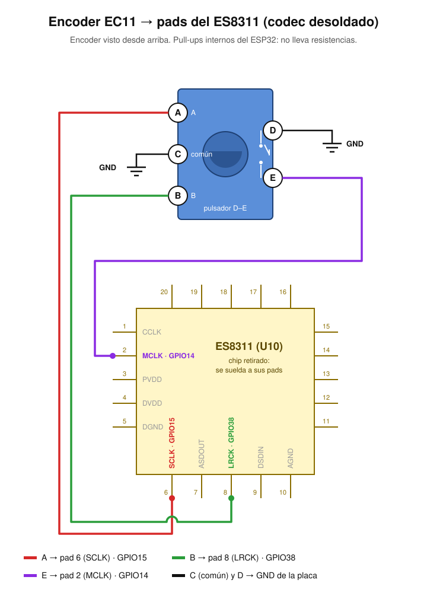
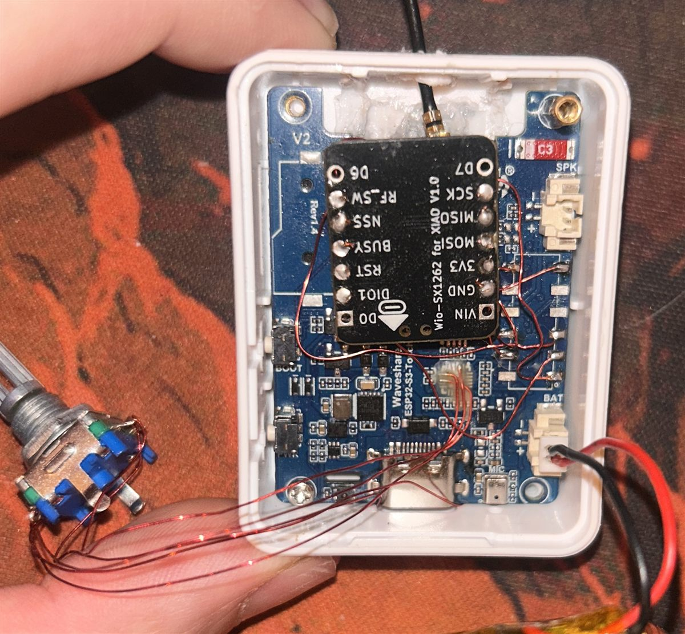

```
 __  __ _____ ____  _   _   ____   _    ____  _____ ____     _   ____  _  _
|  \/  | ____/ ___|| | | | |  _ \ / \  |  _ \| ____|  _ \   / | | ___|| || |
| |\/| |  _| \___ \| |_| | | |_) / _ \ | |_) |  _| | |_) |  | | |___ \| || |_
| |  | | |___ ___) |  _  | |  __/ ___ \|  __/| |___|  _ <   | |_ ___) |__   _|
|_|  |_|_____|____/|_| |_| |_| /_/   \_\_|   |_____|_| \_\  |_(_)____/   |_|
```

Mesh Paper 1.54
===============

**Un nodo Meshtastic de bolsillo con pantalla e-paper, armado con una placa Waveshare y un módulo LoRa de Seeed cableado a mano.**

Versión **v2.8.3-ws154.1** | Basado en el [firmware de Meshtastic](https://github.com/meshtastic/firmware) | *[English README](variants/esp32s3/waveshare_epaper_154/README.md)*

[](https://github.com/valentinvallespinos-coder/firmware/releases/latest)

**Cableás diez hilos, flasheás un `.bin` y tenés un nodo Meshtastic con pantalla e-paper que se lee a pleno sol.**

<p align="center">
  
  &nbsp;
  
</p>
<p align="center"><i>Izquierda: la lista de nodos (42 conocidos, 9 activos). Derecha: el radar apuntando a un nodo a 2 km. A la derecha de la caja, el encoder.</i></p>

* * *

Qué es esto
-----------

Meshtastic no trae soporte para la **Waveshare ESP32-S3-ePaper-1.54**. Esta placa tiene ESP32-S3,
pantalla e-paper, RTC, sensor de temperatura y cargador de batería, pero no tiene radio LoRa.
Este proyecto le suma un **Seeed Wio-SX1262**, le escribe una variante propia de Meshtastic y le
agrega una interfaz pensada para usarla con un **encoder rotativo**: elegís un nodo de la lista,
le escribís con un teclado en pantalla, respondés mensajes, buscás waypoints con una brújula y ves
en un radar quién tenés cerca.

Todo corre sobre **InkHUD**, la interfaz de Meshtastic para pantallas e-paper.

* * *

Hardware
--------

### Necesario

| Pieza | Para qué |
|---|---|
| **Waveshare ESP32-S3-ePaper-1.54**, versión **V2 sin touch** | El cerebro: ESP32-S3-PICO-1-N8R8 (8 MB flash + 8 MB PSRAM), e-paper 200×200, RTC PCF85063, sensor SHTC3, cargador LiPo |
| **Seeed Wio-SX1262 for XIAO** | La radio LoRa. TCXO de 1,8 V, DIO2 como RF switch |
| **Antena LoRa** de tu banda (915 / 868 / 433 MHz) | Sin antena no se transmite: **conectala antes de energizar** |
| Cable esmaltado fino | Para puentear la radio a la placa |

### Opcional

| Pieza | Para qué |
|---|---|
| Batería LiPo | Uso portátil. La placa tiene conector y cargador |
| **Encoder rotativo EC11** con pulsador | Navegación rápida y teclado en pantalla. Hay que desoldar el codec ES8311. Sin encoder, todo se usa con el botón BOOT |
| Teclado **CardKB** (I2C) | Escribir mensajes más rápido |
| **GPS NEO-6M** (GY-NEO6MV2) | Próximamente, ver [Lo que viene](#lo-que-viene) |

* * *

Cómo se hizo
------------

El proyecto se armó por etapas. Cada una se compiló y se probó antes de pasar a la siguiente.

**1. Buscar pines libres.** El problema principal es que la placa no tiene pines libres de sobra. El
header J1 tiene 12 pines, pero dos son **GPIO19/20, que en realidad son el USB** (D− y D+), y el USB
es la única forma de flashear. Revisando el esquemático salió la solución: **la microSD no hace
falta**. Se sacó la tarjeta, se deshabilitó por firmware, y sus pads (CLK, CMD, D0) quedaron para la
radio. El bus SPI va por el header, usando GPIO43/44 (el UART0, que deja de ser consola: la consola
pasa al USB nativo).

**2. Cablear la radio.** El Wio-SX1262 se puenteó a mano con cable esmaltado: SPI y RF_SW al
header, DIO1/BUSY/RESET a los pads de la microSD. Con `SX126x init result 0` en el log, la radio
quedó andando. El módulo va pegado sobre el dorso de la placa, así que todo entra en la caja original.

<p align="center">
  
</p>
<p align="center"><i>Las dos piezas antes de unirlas: la Waveshare y el Wio-SX1262 con los cables esmaltados ya soldados.</i></p>

<p align="center">
  
  &nbsp;
  
</p>
<p align="center"><i>Izquierda: el módulo pegado al dorso. Derecha: todo dentro de la caja, con la antena flexible de Seeed (860–930 MHz).</i></p>

**3. Pantalla.** El e-paper tiene su propio bus SPI y una línea de alimentación (GPIO6) que hay que
activar. Se usa el driver `GDEY0154D67` (familia SSD1681) con InkHUD.

**4. El codec de audio, afuera.** El ES8311 no se usa, así que **se desoldó** y tres de sus líneas
I2S (MCLK, SCLK, LRCK) quedaron libres para el encoder. Se soldó directo a los pads que dejó el chip.
El firmware nunca inicializa el audio.

**5. Encoder → InkHUD.** InkHUD no usa el sistema de entrada estándar de Meshtastic, así que el
encoder tiene su propia capa: una *fuente* que decodifica la cuadratura por interrupción y un
*navegador* que traduce eventos abstractos (arriba, abajo, seleccionar, atrás) a acciones de la
interfaz. Agregar un joystick u otro control más adelante es escribir una clase nueva.

**6. Teclado de un solo eje.** Escribir girando una perilla en una pantalla que tarda medio
segundo en refrescar es un problema. El teclado acumula los clics y redibuja recién 200 ms después
del último, solo en la zona que cambió.

**7. Applets nuevos:** lista de nodos con ficha y mensaje directo, responder mensajes, brújula de
waypoints, radar y pantalla de estado (ver [Funciones](#funciones)).

**8. Batería.** La placa tiene un **latch de alimentación**: el botón PWR la prende solo mientras
lo apretás. El firmware pone GPIO17 en alto apenas arranca, para sostenerla, y lo traba con
`gpio_hold_en` para que sobreviva reinicios y deep sleep. Para apagar, se suelta el latch.

* * *

Cableado
--------

Toda la radio va al **header J1** y a los **pads de la microSD**. No hay que cortar pistas.

<p align="center">
  
</p>
<p align="center"><i>El cableado dibujado sobre el esquemático. Arriba, los pads de la microSD (TF1); al medio, el header J1; abajo, el Wio-SX1262.</i></p>

### Wio-SX1262 → Waveshare ePaper 1.54

```
  ┌──────────────┐                 ┌──────────────────────────┐
  │  Wio-SX1262  │                 │  Waveshare ePaper 1.54   │
  │              │                 │                          │
  │ SCK      ────┼─────────────────┼──── GPIO 1   (J1)        │
  │ NSS      ────┼─────────────────┼──── GPIO 2   (J1)        │
  │ MOSI     ────┼─────────────────┼──── GPIO 43  (J1, TXD)   │
  │ MISO     ────┼─────────────────┼──── GPIO 44  (J1, RXD)   │
  │ RF_SW    ────┼─────────────────┼──── GPIO 3   (J1)        │
  │ DIO1     ────┼─────────────────┼──── GPIO 39  (pad SD CLK)│
  │ BUSY     ────┼─────────────────┼──── GPIO 40  (pad SD D0) │
  │ RESET    ────┼─────────────────┼──── GPIO 41  (pad SD CMD)│
  │ 3V3      ────┼─────────────────┼──── 3V3      (J1)        │
  │ GND      ────┼─────────────────┼──── GND      (J1)        │
  └──────────────┘                 └──────────────────────────┘
```

**microSD:** sin tarjeta. Sus pads ahora son de la radio.
**Consola:** va por el USB nativo. No conectes adaptadores UART a GPIO43/44.
**RF_SW:** GPIO3 comparte línea con el LED verde (vía 24K). Es normal que el LED reaccione.

### Encoder EC11 → pads del ES8311 (chip desoldado)

Primero desoldá el codec ES8311. El encoder va a los pads que deja libres.

<p align="center">
  
  &nbsp;
  
</p>
<p align="center"><i>Izquierda: el cableado del encoder a los pads del codec. Derecha: así queda en la placa, con la radio arriba y la batería conectada.</i></p>

```
  ┌──────────────┐                 ┌──────────────────────────┐
  │    EC11      │                 │ pads del ES8311 (QFN)    │
  │              │                 │                          │
  │ A        ────┼─────────────────┼──── GPIO 15  (pata 6)    │
  │ B        ────┼─────────────────┼──── GPIO 38  (pata 8)    │
  │ PULSADOR ────┼─────────────────┼──── GPIO 14  (pata 2)    │
  │ COMÚN    ────┼─────────────────┼──── GND                  │
  └──────────────┘                 └──────────────────────────┘
```

**Resistencias:** no hacen falta, se usan los pull-ups internos.
**Si el giro va al revés:** intercambiá `ENCODER_PIN_A` y `ENCODER_PIN_B` en `variant.h`.

### ⛔ GPIO19 y GPIO20: no tocar

Aparecen en el header y en la serigrafía como si fueran GPIO libres, pero **son el USB**. Si los
usás para otra cosa, la placa queda sin forma práctica de reflashear.

* * *

Funciones
---------

### Nodes
La lista de nodos ordenada por último escuchado, con saltos (`d` = directo) y antigüedad. Cada nodo
abre una **ficha** con SNR y distancia ("a 3 km al NE"), y tres acciones: **Mensaje directo**,
**Medir señal** (traceroute: con qué SNR nos oyen) y **Radar**.

### Mensajes
Sobre cualquier conversación, un clic del encoder **responde**: si era un DM, al remitente; si era
un canal, al canal.

### Teclado en pantalla
Girás para recorrer las letras, apretás el encoder para elegir y BOOT envía. Tiene minúsculas,
mayúsculas, números, símbolos, espacio y borrar.

### Waypoints
Elegís un waypoint y ves la **distancia y el rumbo**. La brújula va con el **norte arriba**: la
placa no tiene magnetómetro, así que no simula una orientación que no existe: la "N" del dial
siempre marca el norte.

### Radar
Los 10 nodos más cercanos dibujados a escala, con una flecha al más cercano o al que fijaste desde
su ficha.

### Estado
Temperatura y humedad (SHTC3), batería, hora (RTC), vecinos directos, uso del canal y tiempo de aire.

### Controles

| Control | Acción |
|---|---|
| BOOT corto | Abrir/cerrar el menú. En el teclado: **enviar** |
| BOOT largo | Siguiente tile. En el teclado: cancelar |
| Girar el encoder | Cambiar de applet. Dentro de una lista: subir/bajar |
| Encoder corto | Entrar / elegir / responder |
| Encoder largo | Volver |
| PWR 3 s | Apagar |

Sin encoder, **todo se puede hacer con BOOT** y el menú.

* * *

Flashear
--------

1. Bajá el `…factory.bin` del [último release](https://github.com/valentinvallespinos-coder/firmware/releases/latest).
2. **Mantené BOOT apretado mientras enchufás el USB** (modo descarga).
3. Flasheá en la dirección `0x0`:

```sh
pip install esptool
esptool --chip esp32s3 --port COM5 write-flash 0x0 firmware-waveshare-epaper-154-inkhud-*.factory.bin
```

¿Sin Python? Usá [ESP Tool](https://espressif.github.io/esptool-js/) en Chrome o Edge, con la dirección `0x0`.

### Primer arranque
Emparejá el nodo con la app de Meshtastic y **configurá la región LoRa** antes que nada. Tu
posición la toma del celular por Bluetooth.

### A batería
Mantené **PWR apretado 1 o 2 segundos** hasta que aparezca la pantalla. Es el latch de
alimentación, es normal.

### Actualizar sin perder la configuración
Flasheá el `.bin` que no es factory en `0x10000`.

* * *

Compilar desde el código
------------------------

```sh
# Instalá PlatformIO, cloná este repo y:
pio run -e waveshare-epaper-154-inkhud      # build normal, con pantalla
pio run -e waveshare-epaper-154-headless    # solo radio, para aislar problemas
```

El código de la variante está en [`variants/esp32s3/waveshare_epaper_154/`](variants/esp32s3/waveshare_epaper_154/).

* * *

Lo que viene
------------

- **GPS NEO-6M** en el conector del touch (libre en esta versión): TX del GPS a GPIO21, RX a GPIO7.
  Posición propia sin depender del celular.
- Validar a batería el apagado completo y el deep sleep.
- Calibrar la lectura de batería.

* * *

Problemas conocidos
-------------------

| Problema | Solución |
|---|---|
| A batería no prende o se apaga al soltar PWR | Mantené PWR 1–2 s hasta que arranque el firmware |
| `SX126x init result -2` en el log | La radio no responde: revisá el cableado de SPI, NSS y RESET |
| La imagen sale corrida o con basura | El panel puede ser otro modelo: probá el driver `ZJY200200_0154DAAMFGN` |
| El encoder gira al revés | Intercambiá `ENCODER_PIN_A` y `ENCODER_PIN_B` |
| No aparece el puerto para flashear | Mantené BOOT al enchufar el USB |

* * *

Créditos
--------

- [**Meshtastic**](https://meshtastic.org): el firmware, InkHUD y toda la base de este proyecto.
- **Waveshare**: la placa y su [esquemático](https://www.waveshare.com/wiki/ESP32-S3-ePaper-1.54).
- **Seeed Studio**: el módulo Wio-SX1262.

Licencia GPL-3.0, la misma que Meshtastic. Proyecto comunitario no oficial, sin soporte de
Meshtastic ni de Waveshare.

GitHub: [github.com/valentinvallespinos-coder/firmware](https://github.com/valentinvallespinos-coder/firmware)
