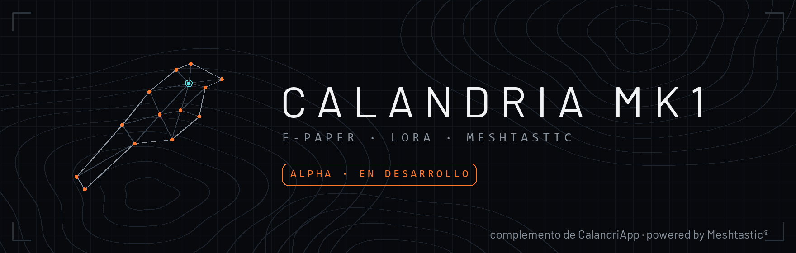
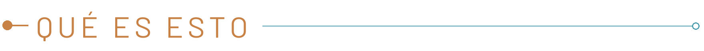
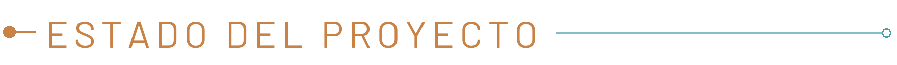
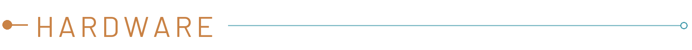
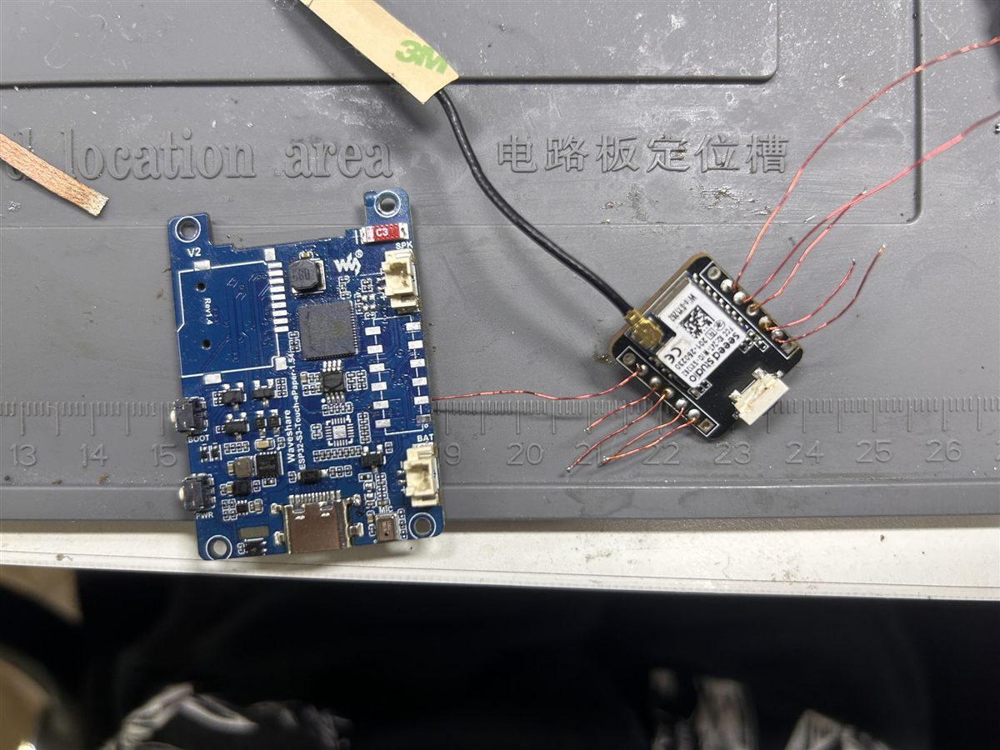
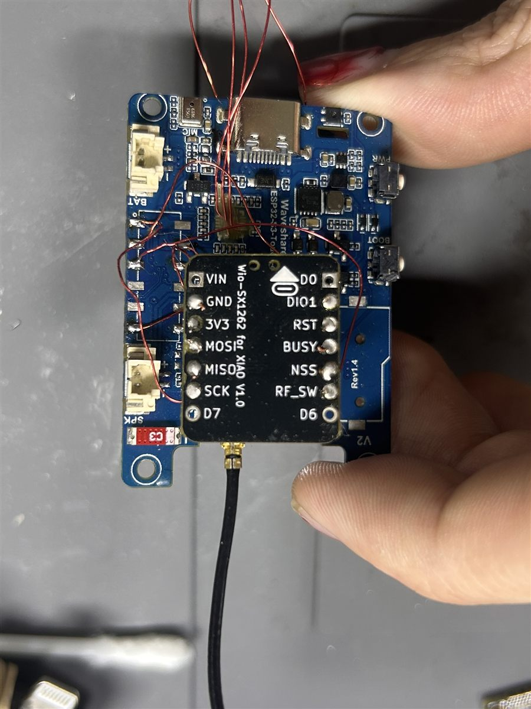
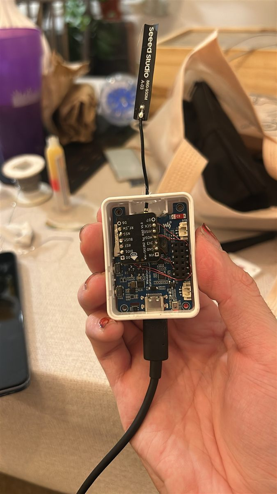
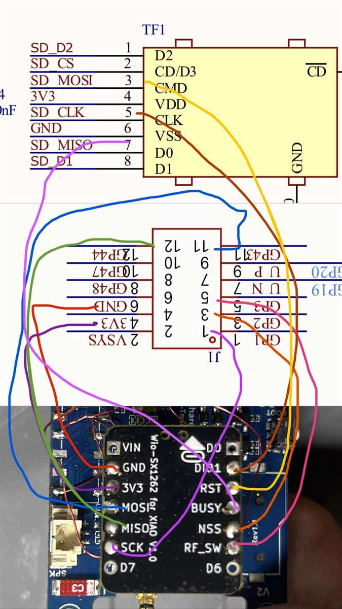

<p align="center"></p>

**Un nodo Meshtastic de bolsillo con pantalla e-paper, armado con una placa Waveshare y un módulo LoRa
de Seeed cableado a mano. Es el complemento de hardware de [CalandriApp](https://github.com/proto-hommer/calandriapp).**

Versión [](https://github.com/proto-hommer/calandria-mk1-epaper/releases/latest) (alpha) | Meshtastic 2.8.3 | [versiones](variants/esp32s3/waveshare_epaper_154/README.es.md#versiones) | *powered by Meshtastic®* | *[English README](variants/esp32s3/waveshare_epaper_154/README.md)*

[](https://github.com/proto-hommer/calandria-mk1-epaper/releases/latest)


**¿Nuevo en esto?** Empezá por [Si recién llegás](#si-recien-llegas): qué es LoRa, qué es una red mesh,
qué es Meshtastic, qué es el MK1 y qué te hace falta para armarlo, y por qué tiene su propia versión.

> [!WARNING]
> **Esto está en alpha, en pleno desarrollo.** La radio, la pantalla y el encoder andan y se usan todos
> los días, pero todavía es un prototipo: va en la caja original de la placa, con la radio puenteada a
> mano, y hay partes sin probar (sobre todo a batería). Cuando estén integrados el **módulo GPS** y la
> **batería 18650 con su cargador TP4056**, se va a diseñar una **carcasa impresa en 3D** que lo aloje
> todo. Puede cambiar cualquier cosa de una versión a otra.

<p align="center">
  
  &nbsp;
  
</p>
<p align="center"><i>Izquierda: la lista de nodos (42 conocidos, 9 activos). Derecha: el radar apuntando a un nodo a 2 km. A la derecha de la caja, el encoder.</i></p>

* * *

<a id="si-recien-llegas"></a>
<p></p>

Si nunca oíste hablar de LoRa ni de Meshtastic, empezá por acá: en cinco minutos sabés qué es todo
esto, qué es el MK1 y qué te hace falta.

<p></p>

Unos aparatos de radio chiquitos llamados **nodos**, que se pasan mensajes de texto y posiciones entre
ellos **sin internet, sin señal de celular y sin pagar abono**. Sirven para salidas al campo o a la
montaña, para coordinar un grupo donde no hay señal, o para cuando se corta todo. El **Calandria MK1**
es uno de esos nodos, de bolsillo y con pantalla: se puede usar solo, con la perilla, o desde el celular
con [CalandriApp](https://github.com/proto-hommer/calandriapp).

<p></p>

**LoRa** (de *Long Range*, "largo alcance") es una forma de transmitir por radio pensada para mandar
**pocos datos muy lejos, gastando muy poca batería**. Pensalo como un walkie-talkie que, en vez de voz,
manda mensajes de texto:

- **Llega lejos:** de 1 a 5 km en la ciudad, de 10 a 20 km con vista despejada, y más de 100 km entre
  cerros altos. Lo que más importa es la altura de la antena y lo que haya en el medio.
- **Gasta poco:** un nodo dura días con una batería chica.
- **Es lento:** pasa un mensaje corto (unos 200 caracteres) o una posición; no fotos, audios ni llamadas.
- **Es libre:** usa una banda de radio que no necesita licencia ni abono. En Argentina es la de
  915 a 928 MHz, que Meshtastic llama región **ANZ**.

En el MK1, la radio LoRa es el **Seeed Wio-SX1262** que va cableado a la placa (ver [Cableado](#cableado)).

<p></p>

*Mesh* quiere decir malla. En una red mesh no hay una antena central ni una empresa en el medio:
**cada nodo repite lo que oye**, y así un mensaje va saltando de uno a otro hasta llegar.

    Vos ───► nodo en un cerro ───► nodo de un vecino ───► tu amigo
                 1.er salto              2.º salto

- Cada repetición es un **salto**. Un mensaje da como mucho 3 saltos (se puede subir hasta 7).
- Cuantos más nodos haya en la zona, más lejos llega todo. Un nodo fijo en un techo o en un cerro (un
  **repetidor**) ayuda a todos los que lo oyen.
- Si un nodo se apaga, los demás siguen repitiendo: no hay un punto único que corte todo.

<p></p>

[Meshtastic](https://meshtastic.org) es un proyecto libre y gratuito que convierte placas LoRa baratas
en nodos de una red mesh. Tiene tres partes: **el firmware** (el programa que corre adentro del nodo;
instalarlo es **flashear**), **la red** (todos los nodos Meshtastic se entienden entre sí, sean de quien
sean) y **las apps** que hablan con el nodo (la oficial y otras, como CalandriApp). Los mensajes viajan
**cifrados**: hay un canal público (LongFast) y se pueden crear canales privados con clave.

**Meshtastic no trae soporte para la placa del MK1**, y por eso existe este repo: es el firmware de
Meshtastic con una variante propia para esta placa y una interfaz para manejarla con la perilla.

<p></p>

1. **Las piezas** de [Hardware](#hardware): la placa Waveshare ESP32-S3-ePaper-1.54, el módulo Seeed
   Wio-SX1262 con su antena, el encoder y cables. Hay que **soldar** unos pocos cables
   (ver [Cableado](#cableado)).
2. **Flashear el firmware** desde Chrome o Edge con el
   [Calandria Flasher](https://proto-hommer.github.io/calandria-flasher/): se enchufa por USB y es un
   botón. No hace falta instalar nada (más detalle en [Flashear](#flashear)).
3. **La antena siempre puesta** mientras esté prendido: transmitir sin antena puede quemar la radio.
4. **Opcional, un celular Android** con [CalandriApp](https://github.com/proto-hommer/calandriapp): como
   el MK1 todavía no tiene GPS, el celular le pasa la posición, y además arma el grupo y edita los
   mensajes rápidos. También anda con la app oficial de Meshtastic.
5. Para hablar con otros, que **ellos también tengan un nodo** Meshtastic (cualquiera, no hace falta
   que sea un MK1) y estén en el mismo grupo.

<p></p>

| Palabra | Qué quiere decir |
|---|---|
| **Nodo** | Cada aparato de radio de la red. El MK1 es uno. |
| **Salto** | Cada vez que otro nodo repite tu mensaje. "Directo" = te oyó sin intermediarios. |
| **Canal** | Una "sala" de chat con su clave. El grupo es un canal privado. |
| **Repetidor** o **router** | Un nodo fijo, puesto en alto, que está para repetir lo de los demás. |
| **Rol** | Cómo se porta un nodo: de mano (cliente), repetidor (router), base… |
| **RSSI** / **SNR** | Qué tan fuerte (dBm: −60 muy fuerte, −120 al límite) y qué tan limpia (dB: positivo es bueno, debajo de −15 al límite) llegó la señal. |
| **Firmware** / **flashear** | El programa del nodo / instalárselo. |
| **e-paper** | Pantalla de "tinta electrónica", como la de un lector de libros: se lee al sol y no gasta mientras no cambia. |
| **InkHUD** | La interfaz de Meshtastic para pantallas e-paper, sobre la que está hecha la del MK1. |
| **Encoder** | La perilla: se gira para moverse y se aprieta para elegir. |
| **Alpha** | Prototipo en desarrollo: anda, pero puede cambiar cualquier cosa. |

<p></p>

Calandria son varios proyectos que se usan juntos, pero cada uno anda solo y va a su ritmo:

| Proyecto | Qué es | Última versión |
|---|---|---|
| [**CalandriApp**](https://github.com/proto-hommer/calandriapp) | La app Android. Anda con **cualquier** nodo Meshtastic con Bluetooth. | [](https://github.com/proto-hommer/calandriapp/releases/latest) |
| **Calandria MK1 epaper** (este repo) | Un nodo de bolsillo con pantalla e-paper, hecho a mano, y su firmware. | [](https://github.com/proto-hommer/calandria-mk1-epaper/releases/latest) |
| [**Calandria Flasher**](https://github.com/proto-hommer/calandria-flasher) | Una página web para instalarle el firmware al MK1 por USB, desde Chrome o Edge. | [abrir](https://proto-hommer.github.io/calandria-flasher/) |
| [**calandria-datos**](https://github.com/proto-hommer/calandria-datos) | Los datos de monte y ciudad que usa la app para calcular el alcance. | — |

**Por qué el MK1 tiene dos números.** El firmware es **Meshtastic 2.8.3** con los cambios del Calandria
encima. Por eso hay dos versiones: la de Meshtastic (2.8.3), que es lo que el nodo les informa a las
apps, y la del **Calandria** (la del badge de arriba), que cuenta nuestros cambios. CalandriApp lee las
dos y te avisa si el MK1 está al día. La app y el MK1 no dependen uno del otro, así que cada uno lleva
su número.

Se numera **X.Y.Z**: **Z** sube con los arreglos, **Y** con funciones nuevas y **X** con un cambio
grande. El MK1 va por la **0.x** porque todavía es **alpha**: llega a 1.0 cuando tenga GPS, batería y
carcasa. Para actualizarlo, el Calandria Flasher. El detalle de cada versión está en
[versiones](variants/esp32s3/waveshare_epaper_154/README.es.md#versiones).

* * *

<p></p>

Meshtastic no trae soporte para la **Waveshare ESP32-S3-ePaper-1.54**. Esta placa tiene ESP32-S3,
pantalla e-paper, RTC, sensor de temperatura y cargador de batería, pero no tiene radio LoRa.
Este proyecto le suma un **Seeed Wio-SX1262**, le escribe una variante propia de Meshtastic y le
agrega una interfaz pensada para usarla con un **encoder rotativo**: elegís un nodo de la lista,
le escribís con un teclado en pantalla o con un mensaje rápido, respondés mensajes, buscás waypoints
con una brújula y ves en un radar quién tenés cerca.

Todo corre sobre **InkHUD**, la interfaz de Meshtastic para pantallas e-paper. La pantalla se lee a
pleno sol y no gasta energía mientras no cambia.

<p></p>

El Calandria MK1 funciona solo, pero está pensado para ir junto con [CalandriApp](https://github.com/proto-hommer/calandriapp),
la app Android del proyecto. Como el nodo **todavía no tiene GPS**, el celular le pasa su posición
por Bluetooth, y la app:

- **lo reconoce como Calandria MK1 epaper**: el nodo se anuncia en un puerto privado (el 323) con su
  modelo y su firmware, y la app muestra si está al día con el último release de este repo;
- edita sus **mensajes rápidos** ("OK", "Voy", "Llegué"…), que después se mandan desde la pantalla
  con el encoder, sin teclado;
- arma el **grupo cerrado** (canal privado + canal público), que en el nodo aparece con su nombre:
  `Canal 1: <grupo> (privado)`, `Canal 0: LongFast (público)`.

También anda con la app oficial de Meshtastic, como cualquier nodo.

* * *

<p></p>

**Alpha.** Se usa de verdad, pero es un prototipo en desarrollo.

<p></p>

- Radio LoRa (Wio-SX1262), pantalla e-paper y encoder, probados en la placa.
- Mensajes de canal y directos, responder, teclado en pantalla y aviso **"No entregado"** con el motivo
  cuando un mensaje vuelve con error.
- El Inicio con las cuatro carátulas: conversaciones, lista de nodos con ficha y medición de señal
  (traceroute), radar, brújulas, estado y ajustes.
- La posición propia se recupera al reiniciar, sin esperar al celular.
- Anuncio de identidad para CalandriApp.

<p></p>

- **A batería:** que el latch la mantenga prendida al soltar PWR, el apagado completo y el deep sleep.
- La **lectura de batería**, que no está calibrada contra una medición real.
- Lo nuevo de la 0.9.0: los **mensajes directos** propios con "entregado", y el **WiFi** con su salida
  de emergencia.
- **GPS:** el módulo todavía no está instalado.

* * *

<a id="hardware"></a>
<p></p>

<p></p>

| Pieza | Para qué |
|---|---|
| **Waveshare ESP32-S3-ePaper-1.54**, versión **V2 sin touch** | El cerebro: ESP32-S3-PICO-1-N8R8 (8 MB flash + 8 MB PSRAM), e-paper 200×200, RTC PCF85063, sensor SHTC3, cargador LiPo |
| **Seeed Wio-SX1262 for XIAO** | La radio LoRa. TCXO de 1,8 V, DIO2 como RF switch |
| **Antena LoRa** de tu banda (915 / 868 / 433 MHz) | Sin antena no se transmite: **conectala antes de energizar** |
| Cable esmaltado fino | Para puentear la radio a la placa |
| **Encoder rotativo EC11** con pulsador | Para moverte por el Inicio y las carátulas, y el teclado en pantalla. Hay que desoldar el codec ES8311 |

<p></p>

| Pieza | Para qué |
|---|---|
| Batería LiPo | Uso portátil. La placa tiene conector y cargador |
| Teclado **CardKB** (I2C) | Escribir mensajes más rápido |
| **GPS NEO-6M** (GY-NEO6MV2) | Próximamente, ver "Lo que viene" |

* * *

<p></p>

El proyecto se armó por etapas. Cada una se compiló y se probó antes de pasar a la siguiente.

**1. Buscar pines libres.** El problema principal es que la placa no tiene pines libres de sobra. El
header J1 tiene 12 pines, pero dos son **GPIO19/20, que en realidad son el USB** (D− y D+), y el USB
es la única forma de flashear. Revisando el esquemático salió la solución: **la microSD no hace
falta**. Se sacó la tarjeta, se deshabilitó por firmware, y sus pads (CLK, CMD, D0) quedaron para la
radio. El bus SPI va por el header, usando GPIO43/44 (el UART0, que deja de ser consola: la consola
pasa al USB nativo).

**2. Cablear la radio.** El Wio-SX1262 se puenteó a mano con cable esmaltado: SPI y RF_SW al
header, DIO1/BUSY/RESET a los pads de la microSD. Con `SX126x init result 0` en el log, la radio
quedó andando. El módulo va pegado sobre el dorso de la placa, así que todo entra en la caja original.

<p align="center">
  
</p>
<p align="center"><i>Las dos piezas antes de unirlas: la Waveshare y el Wio-SX1262 con los cables esmaltados ya soldados.</i></p>

<p align="center">
  
  &nbsp;
  
</p>
<p align="center"><i>Izquierda: el módulo pegado al dorso. Derecha: todo dentro de la caja, con la antena flexible de Seeed (860–930 MHz).</i></p>

**3. Pantalla.** El e-paper tiene su propio bus SPI y una línea de alimentación (GPIO6) que hay que
activar. Se usa el driver `GDEY0154D67` (familia SSD1681) con InkHUD.

**4. El codec de audio, afuera.** El ES8311 no se usa, así que **se desoldó** y tres de sus líneas
I2S (MCLK, SCLK, LRCK) quedaron libres para el encoder. Se soldó directo a los pads que dejó el chip.
El firmware nunca inicializa el audio.

**5. Encoder → InkHUD.** InkHUD no usa el sistema de entrada estándar de Meshtastic, así que el
encoder tiene su propia capa: una *fuente* que decodifica la cuadratura por interrupción y un
*navegador* que traduce eventos abstractos (arriba, abajo, seleccionar, atrás) a acciones de la
interfaz. Agregar un joystick u otro control más adelante es escribir una clase nueva.

**6. Teclado de un solo eje.** Escribir girando una perilla en una pantalla que tarda medio
segundo en refrescar es un problema. El teclado acumula los clics y redibuja recién 200 ms después
del último, solo en la zona que cambió.

**7. Applets nuevos:** lista de nodos con ficha y mensaje directo, responder mensajes, brújula de
waypoints, radar y pantalla de estado (ver "Funciones").

**8. Batería.** La placa tiene un **latch de alimentación**: el botón PWR la prende solo mientras
lo apretás. El firmware pone GPIO17 en alto apenas arranca, para sostenerla, y lo traba con
`gpio_hold_en` para que sobreviva reinicios y deep sleep. Para apagar, se suelta el latch.

**9. La marca y CalandriApp.** El logo de CalandriApp aparece al prender y al apagar, con
"powered by MESHTASTIC®" debajo. Para que la app reconozca al nodo (la app oficial lo ve como
"hardware privado"), el nodo se anuncia en un puerto privado con su modelo y su firmware.

* * *

<a id="cableado"></a>
<p></p>

Toda la radio va al **header J1** y a los **pads de la microSD**. No hay que cortar pistas.

<p align="center">
  
</p>
<p align="center"><i>El cableado dibujado sobre el esquemático. Arriba, los pads de la microSD (TF1); al medio, el header J1; abajo, el Wio-SX1262.</i></p>

<p></p>

```
  ┌──────────────┐                 ┌──────────────────────────┐
  │  Wio-SX1262  │                 │  Waveshare ePaper 1.54   │
  │              │                 │                          │
  │ SCK      ────┼─────────────────┼──── GPIO 1   (J1)        │
  │ NSS      ────┼─────────────────┼──── GPIO 2   (J1)        │
  │ MOSI     ────┼─────────────────┼──── GPIO 43  (J1, TXD)   │
  │ MISO     ────┼─────────────────┼──── GPIO 44  (J1, RXD)   │
  │ RF_SW    ────┼─────────────────┼──── GPIO 3   (J1)        │
  │ DIO1     ────┼─────────────────┼──── GPIO 39  (pad SD CLK)│
  │ BUSY     ────┼─────────────────┼──── GPIO 40  (pad SD D0) │
  │ RESET    ────┼─────────────────┼──── GPIO 41  (pad SD CMD)│
  │ 3V3      ────┼─────────────────┼──── 3V3      (J1)        │
  │ GND      ────┼─────────────────┼──── GND      (J1)        │
  └──────────────┘                 └──────────────────────────┘
```

**microSD:** sin tarjeta. Sus pads ahora son de la radio.
**Consola:** va por el USB nativo. No conectes adaptadores UART a GPIO43/44.
**RF_SW:** GPIO3 comparte línea con el LED verde (vía 24K). Es normal que el LED reaccione.

<p></p>

Primero desoldá el codec ES8311. El encoder va a los pads que deja libres.

<p align="center">
  
  &nbsp;
  
</p>
<p align="center"><i>Izquierda: el cableado del encoder a los pads del codec. Derecha: así queda en la placa, con la radio arriba y la batería conectada.</i></p>

```
  ┌──────────────┐                 ┌──────────────────────────┐
  │    EC11      │                 │ pads del ES8311 (QFN)    │
  │              │                 │                          │
  │ A        ────┼─────────────────┼──── GPIO 15  (pata 6)    │
  │ B        ────┼─────────────────┼──── GPIO 38  (pata 8)    │
  │ PULSADOR ────┼─────────────────┼──── GPIO 14  (pata 2)    │
  │ COMÚN    ────┼─────────────────┼──── GND                  │
  └──────────────┘                 └──────────────────────────┘
```

**Resistencias:** no hacen falta, se usan los pull-ups internos.
**Si el giro va al revés:** intercambiá `ENCODER_PIN_A` y `ENCODER_PIN_B` en `variant.h`.

<p></p>

Aparecen en el header y en la serigrafía como si fueran GPIO libres, pero **son el USB**. Si los
usás para otra cosa, la placa queda sin forma práctica de reflashear.

* * *

<p></p>

<p></p>

El MK1 arranca en el **Inicio**: cuatro carátulas, una por renglón, cada una con su resumen y un
contador. Arriba, tu nombre corto, la batería (⚡ si está enchufada) y la hora.

| Carátula | Qué tiene |
|---|---|
| **MENSAJES** | Las conversaciones, con los sin leer marcados |
| **NODOS** | Los nodos oídos, la ficha de cada uno y el Radar |
| **RUMBO** | Brújula a un nodo, waypoints, mapa del grupo y tu posición |
| **ESTADO** | Batería, canal, ambiente, versión, ajustes y WiFi |

Nunca más de dos niveles: Inicio, carátula, y lo que abrís adentro.

<p></p>

*Grupo* y *Público* primero, después un renglón por cada **directo**, con ● si hay sin leer. Al abrir
una conversación ves cada mensaje con remitente, hora y saltos; los tuyos dicen **"✓ entregado"**,
"enviado" o "no entregado". Clic sobre un mensaje y lo respondés: arriba la cita, después los
**mensajes rápidos** cargados desde la app y al final "Escribir con el teclado". Un mensaje nuevo
aparece solo en pantalla, y BOOT te devuelve a donde estabas.

<p></p>

Todos los nodos, el último oído arriba, con distancia y rumbo ("1,2 km NO") y saltos. Los
**perdidos** van tachados: un cliente a la hora sin oírlo, un router a las 13 horas, igual que en
CalandriApp. Cada nodo abre una **ficha** con cuatro datos (oído, enlace, distancia, batería) y sus
acciones: **mandarle un mensaje**, **medir señal**, **rastrearlo** con la brújula, **favorito** y
**olvidarlo**. *Medir señal* manda un traceroute y muestra la **ida** y la **vuelta** con el SNR de
cada tramo ("VOS -3 dB » BASE -8 dB » JUAN"), cuántos saltos hay y cuál es el tramo más flojo. Al
final de la lista está el **Radar**: los 10 nodos más cercanos dibujados a escala.

<p></p>

Se llama rumbo y no GPS porque el MK1 no tiene GPS: su posición la manda el celular. **Rastrear un
nodo** muestra una flecha grande hacia él, la distancia y el rumbo ("NO 293°"); girando cambiás de
nodo. **Waypoints** los ordena del más cerca al más lejos y abre la misma brújula. También están el
**mapa del grupo** y **mi posición**, con hace cuánto la mandó el celular. La brújula va con el
**norte arriba**: la placa no tiene magnetómetro, así que no simula una orientación que no existe.

<p></p>

Cuatro recuadros: **batería** ("enchufada · cargando", "enchufada · llena" o "a batería"), **uso del
canal**, **ambiente** (temperatura y humedad del SHTC3) y **firmware** (la versión, "al día" o "hay
X.Y.Z" si CalandriApp avisó una más nueva). Abajo, **Ajustes** (ahorro de energía, girar pantalla, hora
local, limpiar fantasmas, reiniciar y el menú completo), **WiFi**, **Bluetooth · PIN** y **Apagar**.

<p></p>

Para dejar el MK1 en casa o en una base fija. **Con el WiFi prendido el Bluetooth se apaga**: en el
ESP32 no andan juntos, así que la app no se puede conectar. La red y la clave se cargan desde la app;
desde *ESTADO → WiFi* se prende y se apaga (reinicia el nodo) y se ve si conectó, con la IP y la
hora por internet. Si no conecta en 3 minutos, el Inicio ofrece apagarlo con un clic. Y sin mirar
la pantalla, **mantener apretada la perilla al prenderlo** arranca con el WiFi apagado y el
Bluetooth andando.

<p></p>

Girás para recorrer las letras, apretás el encoder para elegir y BOOT envía. Tiene minúsculas,
mayúsculas, números, símbolos, espacio y borrar.

<p></p>

Los mismos gestos en todas las pantallas:

| Gesto | Hace |
|---|---|
| Girar el encoder | Moverse por la lista o el contenido |
| Clic del encoder | Entrar / elegir |
| BOOT | Volver un nivel. En el Inicio: el menú completo. En el teclado: **enviar** |
| Mantener BOOT | Volver al Inicio. En el teclado: cancelar |
| Perilla apretada al prender | Arrancar con el WiFi apagado |
| PWR 3 s | Apagar |

* * *

<a id="flashear"></a>
<p></p>

1. Bajá el `…factory.bin` del [último release](https://github.com/proto-hommer/calandria-mk1-epaper/releases/latest).
2. **Mantené BOOT apretado mientras enchufás el USB** (modo descarga).
3. Flasheá en la dirección `0x0`:

```sh
pip install esptool
esptool --chip esp32s3 --port COM5 write-flash 0x0 firmware-calandria-mk1-epaper-*.factory.bin
```

¿Sin Python? Usá [ESP Tool](https://espressif.github.io/esptool-js/) en Chrome o Edge, con la dirección `0x0`.

<p></p>

Emparejá el nodo con CalandriApp o con la app de Meshtastic y **configurá la región LoRa** antes que
nada. Tu posición la toma del celular por Bluetooth.

<p></p>

Mantené **PWR apretado 1 o 2 segundos** hasta que aparezca la pantalla. Es el latch de
alimentación, es normal.

<p></p>

Para actualizar sin perder la configuración, flasheá el `.bin` que no es factory en `0x10000`.

* * *

<p></p>

```sh
# Instalá PlatformIO, cloná este repo y:
pio run -e calandria-mk1-epaper             # build normal, con pantalla
pio run -e calandria-mk1-epaper-headless    # solo radio, para aislar problemas
```

El código de la variante está en [`variants/esp32s3/waveshare_epaper_154/`](variants/esp32s3/waveshare_epaper_154/).
El banner y los títulos de este README salen de `tools/readme_art.py`, con la misma marca y paleta que CalandriApp.

* * *

<p></p>

El Calandria MK1 de hoy es la placa en su caja original con la radio puenteada. Lo que sigue lo
convierte en un equipo terminado:

<p></p>

Un **NEO-6M** (GY-NEO6MV2) en el conector del touch, libre en esta versión: TX del GPS a GPIO21,
RX a GPIO7. Posición propia sin depender del celular, y la brújula usando el rumbo del GPS cuando
hay movimiento.

<p></p>

Una **18650 integrada**, con su módulo de carga **TP4056**, para muchas más horas de uso en el campo.
Antes: validar a batería el latch, el apagado completo y el deep sleep, y calibrar la lectura de batería.

<p></p>

Cuando estén el GPS y la 18650 con su TP4056, se va a **diseñar una carcasa impresa en 3D** que aloje
la placa, la radio, la batería, el GPS, la antena y el encoder.

* * *

<p></p>

| Problema | Solución |
|---|---|
| A batería no prende o se apaga al soltar PWR | Mantené PWR 1–2 s hasta que arranque el firmware |
| `SX126x init result -2` en el log | La radio no responde: revisá el cableado de SPI, NSS y RESET |
| La imagen sale corrida o con basura | El panel puede ser otro modelo: probá el driver `ZJY200200_0154DAAMFGN` |
| El encoder gira al revés | Intercambiá `ENCODER_PIN_A` y `ENCODER_PIN_B` |
| No aparece el puerto para flashear | Mantené BOOT al enchufar el USB |
| "No entregado: … clave" al mandar un DM | El otro nodo tiene una clave tuya vieja: borrá el nodo en los dos lados y dejá que se vuelvan a oír |

* * *

<p></p>

- **powered by Meshtastic®.** Meshtastic® es una marca registrada de Meshtastic LLC. Este proyecto se
  basa en el [firmware de Meshtastic](https://github.com/meshtastic/firmware) y en InkHUD. Es un proyecto
  comunitario independiente: **no es oficial ni está patrocinado ni respaldado por el proyecto
  Meshtastic ni por Waveshare**. Sin garantía: se usa bajo tu propio riesgo.
- **Waveshare**: la placa y su [esquemático](https://www.waveshare.com/wiki/ESP32-S3-ePaper-1.54).
- **Seeed Studio**: el módulo Wio-SX1262.
- **CalandriApp**: la marca (la calandria dibujada como una malla de nodos, con el ojo como nodo
  principal) y la app compañera. Los títulos usan la tipografía Barlow (OFL-1.1).

Software libre bajo la **GPL-3.0**, la misma licencia que Meshtastic.
